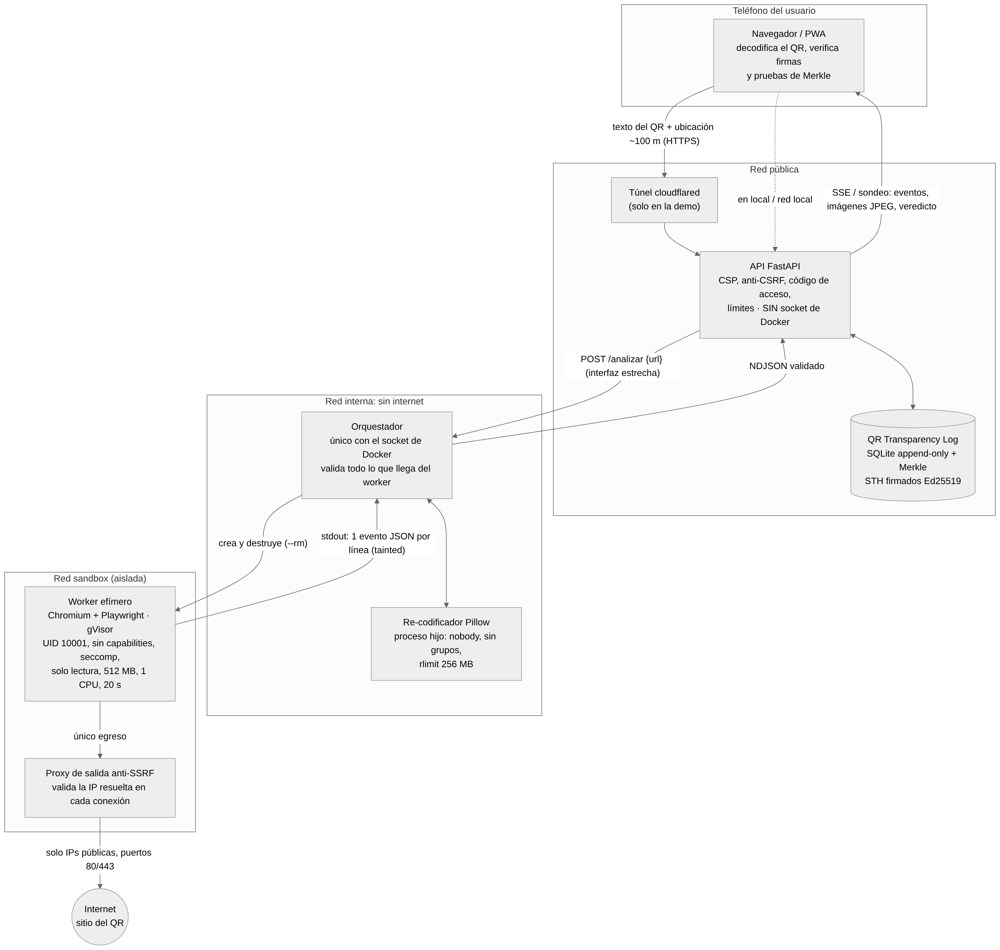
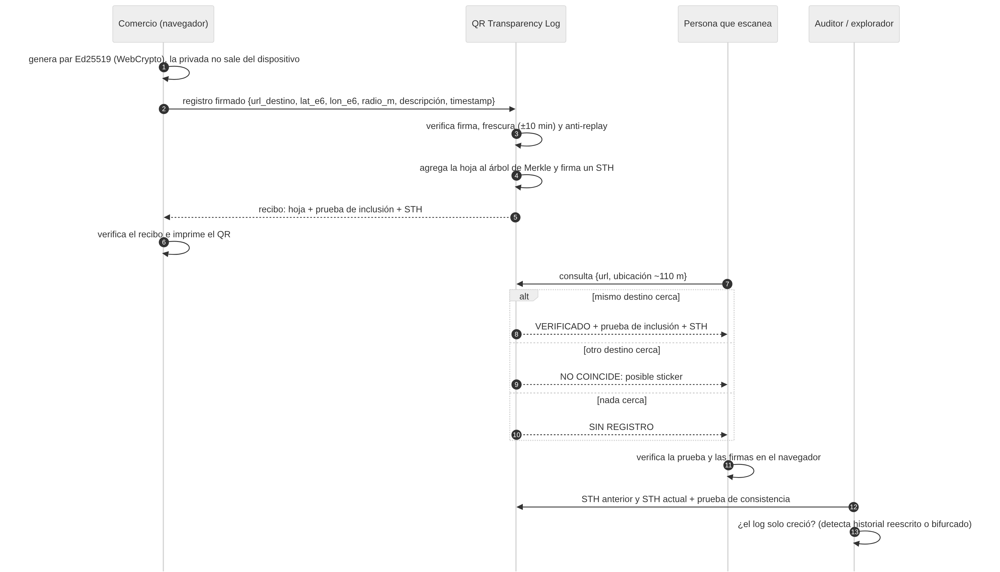
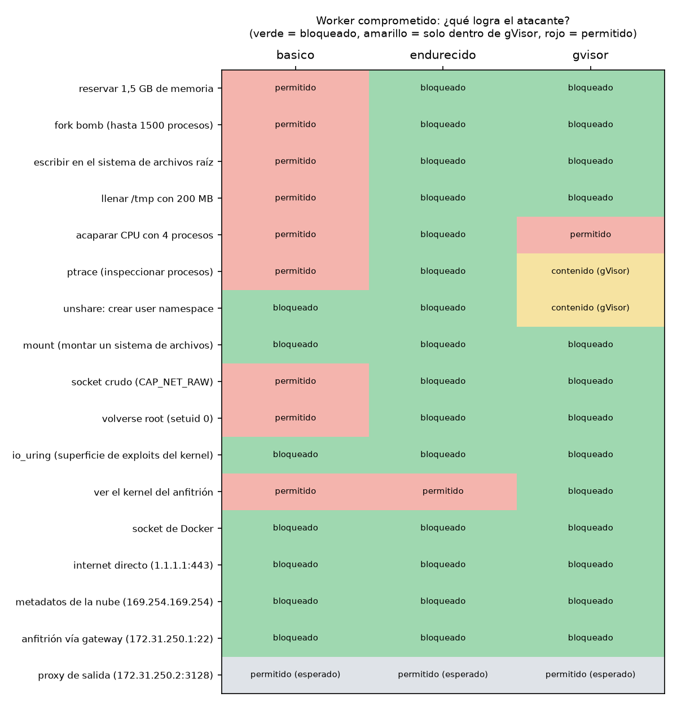
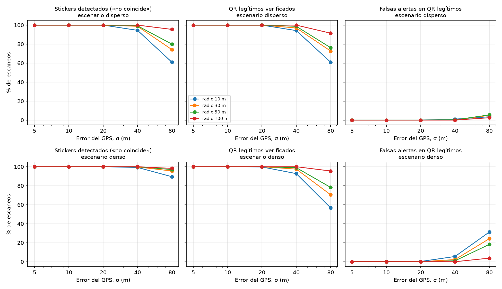

# QR-Sandbox: análisis aislado y procedencia verificable para defenderse del *quishing*

**André Angulo** · Seguridad Computacional, Pontificia Universidad Católica de Chile · noviembre de 2026
Código: <https://github.com/aanguloo/QR-Sandbox>

> **Borrador.** La sección 4.3 (Experimento 1) se completa con la corrida final del 14-nov.

## Resumen

Los códigos QR esconden la dirección a la que llevan, y en el mundo físico basta pegar un
sticker sobre un QR legítimo para desviar pagos o robar credenciales (*quishing*). Las
defensas habituales consultan listas negras, que no conocen los sitios recién creados.
Presentamos **QR-Sandbox**, una aplicación web con dos aportes. (1) La URL nunca se abre en el
teléfono: se analiza en un navegador desechable dentro de un sandbox con separación de
privilegios, gVisor y un proxy anti-SSRF, y todo lo que ese navegador reporta se trata como
dato no confiable. (2) Un **QR Transparency Log**, inspirado en Certificate Transparency, donde
los comercios registran con firma Ed25519 cada QR físico y su ubicación. Así, un QR que en ese
lugar lleva a otro destino se detecta como posible sticker, aunque el sitio falso sea nuevo.
En nuestros experimentos, con GPS de precisión normal (σ ≤ 20 m), el log detectó el 100 % de
los stickers sin falsas alarmas. Frente a un atacante que ya ejecuta código dentro del sandbox,
la configuración endurecida redujo de 9 a 1 los objetivos que logra (de 17 probados), mientras
que con Docker por defecto logra 9.

## 1. Qué hicimos

Construimos un sistema completo y reproducible (`make up`, `make test`, `make demo`):

- **Una web instalable en el teléfono (PWA)** que decodifica el QR en el propio navegador,
  muestra el destino **antes** de abrir nada y lo manda a analizar. Mientras el análisis
  ocurre, muestra **en vivo** lo que hace el enlace (redirecciones, dominios contactados,
  formularios de contraseña, permisos pedidos) y lo que "ve" el navegador aislado, solo como
  imágenes. Termina con un **veredicto explicado** en lenguaje simple.
- **Un sandbox de análisis dinámico** con separación de privilegios en tres componentes
  (API, orquestador y worker efímero), aislamiento con gVisor, seccomp y límites de recursos,
  y un **proxy de salida anti-SSRF** propio.
- **Un QR Transparency Log** (árbol de Merkle según RFC 9162, *signed tree heads*, pruebas de
  inclusión y de consistencia, revocación) con un panel para comercios que genera la clave
  Ed25519 **en el navegador**, y un explorador y un auditor que verifican el log sin confiar en
  el servidor.
- **Tres experimentos reproducibles** (detección, contención y stickers), más 331 tests
  unitarios y 25 de integración, incluidas pruebas en un Chromium real.
- **Una demo pública** a través de Cloudflare Tunnel, protegida con un código de acceso para que
  no pueda usarse como proxy abierto.

## 2. Por qué es relevante

Un QR es una URL dentro de una imagen. Eso le quita al usuario las dos defensas que sí tiene
frente a un enlace en un correo: ver la dirección antes de hacer clic y que un filtro
corporativo la revise. El QR se escanea con el teléfono personal, fuera del perímetro, y la
cámara suele abrir el destino de inmediato. En el mundo físico el ataque es aún más barato:
basta pegar un sticker sobre el QR de un parquímetro, de la carta de un restaurante o de un
cartel de pagos.

Las herramientas actuales responden sobre todo con **listas negras** de sitios reportados.
Funcionan bien con amenazas conocidas, pero un sitio de phishing creado esta mañana no está
en ninguna lista hasta que alguien lo reporta, y para el sticker físico el problema es aún
peor: el sitio falso puede ser nuevo, verse idéntico al original y no tener nada que lo delate
salvo **no ser el que el comercio puso ahí**. Nuestra hipótesis es que dos cosas ayudan donde
las listas negras fallan: mirar **qué hace** el enlace (análisis dinámico) y poder comprobar
**de quién es** el QR físico (procedencia verificable).

## 3. Cómo lo hicimos

### 3.1 Arquitectura y separación de privilegios

Aplicamos la separación de privilegios de OpenSSH y OKWS [1, 2]: cada componente tiene el
mínimo poder posible y las interfaces entre ellos son estrechas (Figura 1).

- La **API** atiende internet, pero **no tiene el socket de Docker**. Para analizar una URL
  solo puede llamar a una operación del orquestador, `POST /analizar {url}`, a través de una
  red interna sin puertos publicados.
- El **orquestador** es el único con el socket de Docker, es decir, el único equivalente a root
  en el anfitrión. Crea un contenedor por análisis, lo destruye siempre (en un `finally`, y
  comprueba que ya no exista) y limpia restos al arrancar.
- El **worker** es el dominio sacrificable: Chromium (Playwright) que **solo carga** la página.
  Nunca hace clic ni escribe datos, y bloquea descargas, ventanas emergentes y diálogos. No
  tiene conexión con la API ni con el navegador del usuario: su única salida es stdout.

### 3.2 Aislamiento del worker

Definimos tres perfiles, para poder medir cuánto aporta cada capa:

| Perfil | Configuración |
|---|---|
| `basico` | Docker por defecto (root dentro del contenedor, seccomp por defecto); solo para comparar |
| `endurecido` | UID 10001, `--cap-drop=ALL`, `no-new-privileges`, **seccomp propio**, FS de solo lectura + tmpfs de 128 MB, 512 MB sin swap, 1 CPU, 256 procesos, timeout de 20 s |
| `gvisor` (por defecto) | `endurecido` + runtime `runsc`: las syscalls las atiende el kernel de gVisor en espacio de usuario [3] |

El seccomp propio parte del perfil de Docker y quita 20 syscalls que Chromium no necesita y
que son superficie histórica de escalamiento: `ptrace`, `process_vm_*`, `userfaultfd`, `bpf`,
`io_uring_*`, `keyctl` y `name_to_handle_at`, entre otras. Si `runsc` no está disponible, el
sistema lo detecta, usa `endurecido` y lo deja registrado en el resultado.

La red también es una capa: el worker vive en una red Docker `internal` donde la única otra
máquina es el proxy. Al probarla descubrimos que, aun siendo `internal`, un contenedor
alcanzaba servicios del anfitrión a través del gateway del bridge. Lo cerramos con
`inhibit_ipv4`, que deja al anfitrión sin IP en esa red, y lo cubrimos con un test.

### 3.3 Proxy de salida anti-SSRF

La página analizada puede intentar que el sandbox ataque la red interna: `localhost`, la API,
los metadatos de la nube en `169.254.169.254`. Nuestro proxy (asyncio, solo biblioteca estándar)
resuelve el nombre **una vez**, rechaza la conexión si **cualquiera** de las IPs resueltas no es
global (privadas, loopback, link-local, CGNAT, multicast, e IPv6 que esconden una IPv4 interna:
`::ffff:a.b.c.d`, 6to4, Teredo, NAT64) y se conecta **a la IP ya validada**, sin volver a
resolver. Esto último cierra el *DNS rebinding*. Cada redirección es una conexión nueva, así que
también se valida. Chromium se configura para que ni siquiera `127.0.0.1` se salte el proxy, y
el worker se niega a navegar si no tiene el proxy configurado (falla cerrado).

### 3.4 Datos no confiables y canal en vivo

Siguiendo la idea de RLBox [4], suponemos que el worker **puede estar comprometido y mentir**.
Todo lo que emite pasa por varios filtros:

1. **Esquema cerrado**: el tipo de evento sale de una lista fija, no se admiten campos extra,
   los largos están acotados y las URLs se normalizan (solo http/https; los dominios
   internacionales pasan a punycode).
2. **Topes** por línea, por total de bytes y por cantidad de eventos; si se exceden, el
   orquestador mata al worker.
3. **Filtro de tasa** con el reloj del orquestador, que agrupa los excedentes
   ("+230 requests a dominios de terceros").
4. Las **imágenes** del screencast (CDP, ~2,5 fps) se tratan como posibles exploits contra el
   decodificador: se revisan los *magic bytes* y el tamaño, y se **re-codifican con Pillow en
   un proceso hijo** que corre como `nobody` sin grupos (no puede tocar el socket de Docker),
   con límites de memoria, archivos y procesos, y que se relanza si muere.

El orquestador transmite los eventos ya validados y la API los vuelve a validar (defensa en
profundidad) antes de enviárselos al navegador por Server-Sent Events. Al navegador **solo le
llegan datos con esquema fijo e imágenes JPEG**; nunca HTML ni scripts del sitio analizado.

### 3.5 QR Transparency Log

El aporte principal adapta Certificate Transparency [5, 6] a los QR físicos (Figura 2):

- **Registro.** El comercio genera un par Ed25519 con WebCrypto (la clave privada no sale del
  dispositivo) y firma `{url_destino, lat, lon, radio, descripción, timestamp}` en un formato
  canónico que Python y JavaScript reproducen byte a byte. Las coordenadas van como enteros,
  porque los decimales se serializan distinto en cada lenguaje.
- **Log.** El servidor verifica la firma, la frescura (±10 min) y que la solicitud no sea un
  reenvío, agrega la hoja a un árbol de Merkle y firma un *signed tree head* (STH). El recibo
  incluye la prueba de inclusión, y el navegador lo verifica antes de imprimir el QR.
- **Escaneo.** Con la URL y la ubicación redondeada a ~110 m, el log responde **verificado**
  (un QR registrado cerca con el mismo destino, más su prueba de inclusión), **no coincide**
  (un QR registrado cerca con **otro** destino: posible sticker) o **sin registro**.
- **Auditoría.** El explorador recuerda el último STH visto y, en cada visita, pide una prueba
  de consistencia para comprobar que el log **solo creció**. Un auditor por línea de comandos
  hace lo mismo, recalcula la raíz desde las hojas y verifica cada firma.
- **Revocación.** Solo la misma clave que registró un QR puede revocarlo, y la revocación es
  otra hoja auditable. Al probarla encontramos que reenviar la solicitud firmada original
  **reactivaba un QR revocado**. Lo corregimos: una firma solo se acepta una vez.

La garantía es criptográfica, no de la base de datos: SQLite tiene *triggers* contra
modificaciones, pero las pruebas se calculan siempre desde los datos crudos, y si alguien
altera una hoja, la verificación falla. El árbol reproduce los vectores oficiales de
Certificate Transparency, y `cripto.js`, el verificador del navegador, se prueba contra
Python con 210 pruebas de inclusión y 190 de consistencia.

### 3.6 Señales y veredicto explicable

El veredicto es una **suma de pesos de una tabla fija**, sin aprendizaje automático: cada punto
del puntaje (0–100) se rastrea a una razón escrita. Con 70 o más el resultado es *peligroso*,
entre 35 y 69 *sospechoso*, y bajo 35 *sin alertas*; nunca decimos "seguro".

- **Señales estáticas**, sin abrir la URL: listas negras offline (OpenPhish y Phishing.Database
  con snapshots fechados), imitación de 66 marcas (homoglifos, sustituciones como `micr0soft`,
  typosquatting, nombre de la marca en un dominio ajeno), `@` que esconde el dominio real, IP
  literal, terminaciones baratas, acortadores, rastreadores de IP, hosting gratuito con nombre
  generado al azar, edad del dominio (RDAP, y el
  whois de NIC Chile para `.cl`) y certificado TLS. Para leer el certificado nos conectamos al
  sitio del atacante con la misma política anti-SSRF del proxy.
- **Señales dinámicas**: redirecciones, cambio de dominio, formularios de contraseña, marca
  en la página de un dominio ajeno, descargas y permisos pedidos (ubicación, cámara,
  notificaciones).
- **El log**: *no coincide* suma +60 (por sí solo deja el resultado en *sospechoso*);
  *verificado* resta 40, pero no es un pase libre ante un phishing evidente.

Por ejemplo: "Vas a login-micr0soft.xyz: usa un 0 en lugar de una o para imitar a Microsoft,
el dominio se creó hace 2 días, pasa por 4 redirecciones y muestra la marca Microsoft en un
dominio que no es de Microsoft". Cada razón incluye un "¿Qué significa?" para personas sin
conocimientos técnicos.

### 3.7 Seguridad de la aplicación web y de la demo

Todo texto que viene del sitio analizado (títulos, URLs) es entrada del atacante y se inserta
con `textContent`. Un test prohíbe `innerHTML`, `eval` y scripts o estilos *inline*. La CSP solo
permite scripts propios; `frame-ancestors 'none'` y `X-Frame-Options` impiden el clickjacking.
Las peticiones que modifican estado exigen una cabecera propia, `Content-Type` JSON y `Origin`
igual al del servidor (anti-CSRF). La demo pública agrega un **código de acceso** que se guarda
en una cookie `HttpOnly; Secure; SameSite=Strict` firmada (HMAC) y que vence a las 12 h, más
límites por persona (usando la IP real que entrega Cloudflare) y globales.

### 3.8 Metodología de evaluación y ética

Escribimos los tests junto al código (331 unitarios y 25 de integración con Docker, gVisor,
internet y Chromium real) y diseñamos tres experimentos reproducibles con un comando cada uno
(`make exp1/exp2/exp3`). Reglas éticas: el sandbox solo carga páginas; las URLs maliciosas
vienen solo de feeds públicos de investigación, con como máximo un análisis cada 2 s; las
pruebas de contención usan solo páginas propias servidas localmente; no guardamos datos
personales.

## 4. Resultados

### 4.1 Experimento 2: contención

**Worker comprometido (B).** Supusimos que un exploit ya dio al atacante ejecución de código en
el contenedor y probamos 17 objetivos con cada perfil (Figura 3).

| Objetivo | `basico` | `endurecido` | `gvisor` |
|---|---|---|---|
| Reservar 1,5 GB de memoria | logrado | OOM a ~400 MB | sandbox entero terminado (OOM) |
| Fork bomb (1500 procesos) | 1500 creados | se detiene en 255 | sandbox entero terminado |
| Escribir en el sistema / llenar /tmp | sí / 200 MB | no / 128 MB | no / 128 MB |
| Acaparar CPU (4 procesos) | ~3,3 núcleos | ~1,0 | **~1,7** |
| `ptrace`, socket crudo, volverse root | sí | no | `ptrace` solo dentro de gVisor; resto no |
| Ver el kernel del anfitrión | sí | **sí** | no (kernel simulado) |
| Internet directo, metadatos, anfitrión, socket de Docker | no | no | no |
| **Objetivos logrados (de 17)** | **9** | **1** | **1** (+2 contenidos en gVisor) |

El endurecimiento hace casi todo el trabajo. gVisor agrega ocultar el kernel real y cambiar el
blanco del ataque: un escape tendría que vulnerar primero el kernel de gVisor y luego el del
anfitrión. Su límite de CPU, en cambio, fue menos estricto.

**Páginas hostiles (A).** Diez páginas propias analizadas por el sistema completo con cada
perfil. En las 30 corridas el contenedor se eliminó. Resultados por página:

- **SSRF:** 21–31 intentos bloqueados por el proxy (loopback, privadas, metadatos, puertos no
  web, DNS).
- **Memoria:** sin límite, la página alcanzó 1,6 GB; con límite, el renderer murió o, en
  gVisor, se terminó el sandbox.
- **CPU e hilos:** los cortó el timeout de 20 s.
- **Bucle de redirecciones:** Chromium lo cortó a las 20.
- **Descarga forzada:** bloqueada y reportada.
- **Permisos:** se detectaron los pedidos de ubicación y notificaciones.
- **Inundación de 5000 requests:** quedó en 28 eventos visibles y el resto agrupado.

Un **worker inundador**, que emite 300 mil eventos y líneas de 500 KB, fue cortado en ~0,5 s,
con un pico de 0,4 MB de memoria en el orquestador.

**Costo.**

| Medición | Resultado |
|---|---|
| Arranque de un contenedor (10 repeticiones) | igual en los tres perfiles: 366–370 ms (p50) |
| Duración de análisis cortos (4 páginas, 1 corrida c/u) | `basico` 2,79 s · `endurecido` 2,95 s (+6 %) · `gvisor` 4,32 s (+55 %) |
| Re-codificación aislada de frames (6 sitios × 2) | mediana 14 ms por frame (6–32 ms), 1,6 % de la duración del análisis |
| Imágenes que viajan al teléfono por análisis | 15–390 KB (mediana 144 KB) |

En resumen, el costo de gVisor está en la **ejecución** de Chromium, que hace muchas syscalls,
y no en el arranque del contenedor.

### 4.2 Experimento 3: detección de stickers

Simulamos con el log real 40 comercios en dos escenarios: **disperso** (4 × 4 km) y **denso**
(300 × 300 m, como un patio de comidas). Variamos el radio registrado (10–100 m) y el error del
GPS (σ = 5–80 m), con 400 escaneos por escenario y configuración (legítimo, sticker y sin
registro).

- Con GPS normal (σ ≤ 20 m): **100 % de stickers detectados, 100 % de QR legítimos
  verificados y 0 % de falsas alertas** en ambos escenarios, con cualquier radio. Los
  escaneos en lugares sin registro dieron siempre *sin registro*.
- Con GPS muy impreciso (σ = 80 m), el rendimiento cae, y en la zona densa aparecen **falsas
  alertas** cuando el escaneo legítimo "cae" junto al QR de otro comercio: 31 % con radio de
  10 m, 24 % con 30 m y 4 % con 100 m. Un radio mayor protege más, a costa de que los registros
  cubran más espacio.
- La consulta crece en forma lineal con el tamaño del log (de 0,24 ms con 10 entradas a 4,3 ms
  con 2000), porque recalcula el árbol desde los datos crudos. Verificar la prueba en el
  cliente toma ~0,01 ms y la prueba ocupa 11 hashes (352 bytes) con 2000 entradas.

### 4.3 Experimento 1: detección de phishing *(pendiente)*

> **[PENDIENTE: corrida final ~14-nov.]** Se reemplaza con la tabla de métricas, la Figura 5
> (`exp1_metricas.png`), la distribución de puntajes y el análisis de falsos negativos.

**Diseño.** Unas 300 URLs maliciosas que aparecen **por primera vez** en el snapshot de
OpenPhish de la fecha de prueba, y 300 benignas: 50 sitios chilenos comunes, 158 sitios
legítimos en hosting gratuito y dominios de Tranco [7] en los puestos 10.001 a 110.000. Comparamos cuatro métodos:

- **(A)** solo listas negras de días **anteriores**;
- **(A\*)** la lista del mismo día, como cota optimista;
- **(B)** heurísticas estáticas;
- **(C)** estático más dinámico en el sandbox.

Medimos precisión, recall, F1, tasa de falsos positivos y latencia p50/p95. La **separación
temporal** es clave: si la lista negra de (A) incluyera las URLs de prueba, su recall sería
100 % por construcción.

**Piloto (solo para validar el instrumento).** Con 8 + 8 URLs, (B) y (C) detectaron 4 de 8 sin
falsos positivos. Los falsos negativos fueron sitios en `*.pages.dev`, un hosting gratuito, con
nombres aleatorios.

**Una señal nueva, diseñada sin mirar los datos de prueba.** Con los datos de desarrollo
(el snapshot del 6-nov) vimos que 155 de 300 phishing estaban en hosting gratuito (Cloudflare
Pages, Vercel, GitHub Pages, Blogspot…). Ahí la edad del dominio y el certificado son de la
plataforma y no delatan nada. Agregamos dos señales: `hosting_gratuito` (+10, solo informa) y
`nombre_generado` (+25), que reconoce nombres creados en masa (letras y números mezclados al
azar, fechas, muchos dígitos). Para medir falsos positivos reunimos 316 sitios legítimos
reales en esas plataformas (páginas oficiales de repositorios populares de GitHub) y los
partimos al azar. Con la mitad de desarrollo, las reglas detectan el 69 % del phishing en
hosting gratuito y **0 de 158** legítimos; descartamos a propósito rasgos frecuentes en
sitios legítimos, como un número dentro de una palabra (`cs231n`) o el sufijo que Netlify
pone por defecto. La otra mitad, que no miramos, forma parte del conjunto benigno de la
prueba final, cuyos falsos positivos se reportan por fuente.

## 5. Aprendizajes y limitaciones

**Hallazgos durante el desarrollo**, la mayoría encontrados porque escribimos tests adversos:

1. Una red Docker `internal` no aísla del anfitrión: el gateway del bridge seguía alcanzable.
2. Con gVisor se ignora el seccomp de Docker (`ptrace` funciona dentro del sandbox), porque las
   syscalls no llegan al kernel del anfitrión. Las dos capas son alternativas, no se suman.
3. Con gVisor, exceder la memoria termina el sandbox completo, no solo el proceso; y su
   límite de CPU es más laxo (~1,7 núcleos con un límite de 1).
4. **Replay** de una solicitud firmada para reactivar un QR revocado (corregido).
5. **Falso positivo real**: `github.com/login` salía *peligroso* (contraseña + "Continue with
   Google"). Las menciones de inicio de sesión social ya no cuentan como suplantación.
6. El túnel gratuito de Cloudflare retiene los primeros ~500 KB de un SSE. Descartamos las
   cabeceras, el relleno y HTTP/2 como causa; la web cambia sola a sondeo si en 2,5 s no
   recibe nada.
7. Las fuentes de datos cambian: URLhaus cerró sus descargas masivas y Phishing.Database
   incluye dominios populares legítimos (gravatar.com, amazon.ie), por lo que usamos Tranco
   para filtrarlos.

**Limitaciones.**

- El orquestador equivale a root en el anfitrión porque tiene el socket de Docker.
- El log vive en el proceso de la API: un compromiso de la API permitiría firmar STHs falsos.
  Eso se *detecta* (auditoría de consistencia), pero no se *impide*, y no hay *gossip* entre
  auditores.
- No hay defensa contra *cloaking*: un sitio puede mostrarle otra cara a un navegador
  automatizado.
- El sitio analizado ve la IP del equipo que analiza.
- Las señales son públicas, así que un atacante puede intentar evitarlas.
- El log prueba posesión de una clave, no la identidad legal del comercio.
- En zonas densas con GPS impreciso hay falsas alertas.
- El reconocimiento visual de logos quedó fuera de alcance: lo aproximamos con texto
  alternativo, nombres de archivo y favicon.

El modelo de amenaza completo está en `docs/modelo-de-amenaza.md`.

## 6. Conclusión

Mostramos que es posible analizar un QR sin que el teléfono toque el destino, con un sandbox
cuya contención medimos capa por capa. También mostramos que un registro público y
verificable, al estilo de Certificate Transparency, permite detectar el ataque físico del
sticker, que es invisible para las listas negras, con precisión casi perfecta mientras el GPS
funcione razonablemente. Ambas piezas son explicables: el usuario ve qué hizo el enlace, por
qué el veredicto es el que es y puede verificar el registro en su propio navegador.

## Referencias

1. N. Provos, M. Friedl, P. Honeyman. *Preventing Privilege Escalation*. USENIX Security, 2003.
2. M. Krohn. *Building Secure High-Performance Web Services with OKWS*. USENIX ATC, 2004.
3. E. Young et al. *The True Cost of Containing: A gVisor Case Study*. HotCloud, 2019.
4. S. Narayan et al. *Retrofitting Fine Grain Isolation in the Firefox Renderer* (RLBox). USENIX Security, 2020.
5. B. Laurie, A. Langley, E. Kasper. *Certificate Transparency*. RFC 6962, 2013.
6. B. Laurie, E. Messeri, R. Stradling. *Certificate Transparency Version 2.0*. RFC 9162, 2021.
7. V. Le Pochat et al. *Tranco: A Research-Oriented Top Sites Ranking Hardened Against Manipulation*. NDSS, 2019.
8. OpenPhish (feed comunitario) y Phishing.Database (github.com/Phishing-Database), consultados en noviembre de 2026.
