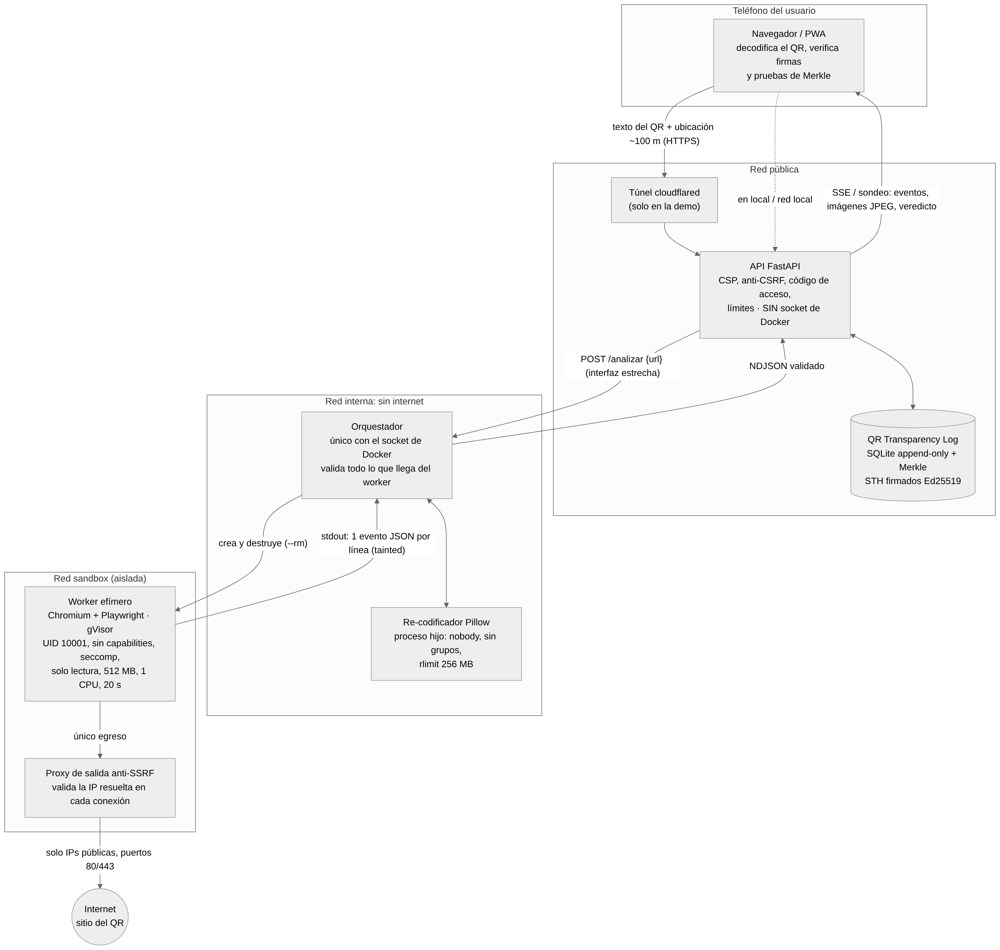

# Modelo de amenaza de QR-Sandbox

Este documento define qué protege QR-Sandbox, de quién y con qué supuestos. Cada amenaza
apunta a la mitigación implementada, al archivo donde vive y a la evidencia que la respalda
(test o experimento). Lo que no se pudo cubrir queda explícito en *Riesgos residuales* y
*Fuera de alcance*.

## 1. Sistema y fronteras de confianza

Una persona escanea un QR en su teléfono. La web decodifica el QR en el navegador y envía la
URL, junto con su ubicación redondeada a ~110 m si la persona lo permite, a la **API**. La API
no tiene acceso a Docker: le pide al **orquestador**, por una red interna y mediante una
única operación ("analizar URL"), que abra la URL en un **worker** efímero (Chromium en
gVisor). La única salida a internet del worker es un **proxy anti-SSRF**. El worker solo
escribe eventos JSON en su stdout; el orquestador los valida y los transmite a la API, que
los re-valida y se los envía al navegador. En paralelo, la API calcula señales estáticas y
consulta el **QR Transparency Log**, donde los comercios registran sus QRs con firmas Ed25519.

| Frontera | Del lado menos confiable | Regla |
|---|---|---|
| F1 navegador ↔ API | cualquier cliente de internet (en la demo) | validar toda entrada; anti-CSRF; código de acceso; límites de tasa |
| F2 API ↔ orquestador | la API (expuesta a internet) | interfaz estrecha: solo `POST /analizar {url}`; red interna sin puertos publicados |
| F3 orquestador ↔ worker | el worker (ejecuta páginas hostiles) | **todo lo que sale del worker es tainted**: esquema cerrado, topes, re-codificación aislada |
| F4 worker ↔ internet | el sitio del QR | egreso solo por el proxy, que valida la IP resuelta en cada conexión |
| F5 comercio ↔ log | quien envía un registro | firma Ed25519 de la clave dueña; frescura; anti-replay |
| F6 log ↔ lectores | el operador del log | pruebas de inclusión y consistencia verificables por el cliente (no hay que confiar en el servidor) |

## 2. Activos

| Activo | Por qué importa |
|---|---|
| **A1** Teléfono y datos de quien escanea | El objetivo del atacante: credenciales, pagos, malware. |
| **A2** El anfitrión y el daemon de Docker | Quien controla el socket de Docker es root en el anfitrión. |
| **A3** Red interna y servicios locales | API, orquestador, servicios del anfitrión, metadatos de nube (blancos de SSRF). |
| **A4** Integridad del log y su clave | Si el log miente, un sticker podría verse como "verificado". |
| **A5** Claves de los comercios | Permiten registrar y revocar QRs a nombre del comercio. |
| **A6** Veracidad del veredicto | Un veredicto engañado ("sin alertas" ante un phishing) o falsas alarmas. |
| **A7** Disponibilidad del servicio | Cada análisis levanta un navegador: es caro. |
| **A8** Privacidad de la ubicación | Quién escaneó qué, y dónde. |
| **A9** Reputación de nuestra IP | El servicio no debe convertirse en un proxy abierto para atacar a terceros. |

## 3. Adversarios y capacidades

- **Adversario A (remoto, controla la página de destino):** sirve HTML/JS arbitrario, redirige
  a donde quiera, controla su DNS (rebinding), intenta SSRF, agota recursos, pone títulos y
  textos hostiles (XSS contra nuestra web), envía imágenes malformadas, muestra contenido
  distinto a los bots (*cloaking*) y puede tener un exploit contra Chromium. En el peor caso
  ejecuta código **dentro del worker** y puede mentir en todo lo que este reporta.
- **Adversario B (físico):** pega un QR falso sobre uno legítimo. Puede crear un sitio nuevo,
  sin historial en listas negras, idéntico al original.
- **Adversario C (contra el log):** intenta registrar QRs a nombre de otro comercio, revocar QRs
  ajenos, reactivar un QR revocado reenviando una solicitud vieja, o, como **operador
  malicioso del log**, reescribir el historial o mostrar versiones distintas a distintas
  personas.
- **Adversario D (abusa del servicio público):** usa la demo como proxy abierto contra terceros,
  la satura (DoS), adivina el código de acceso por fuerza bruta o intenta CSRF/clickjacking
  contra quien la usa.

## 4. Amenazas, mitigaciones y evidencia

| # | Amenaza | Mitigación | Dónde | Evidencia |
|---|---|---|---|---|
| T1 | A abre la URL en el teléfono de la víctima | La URL **nunca** se abre en el teléfono: se decodifica, se muestra y se analiza en el worker. "Abrir de todas formas" pide una confirmación explícita y usa `rel=noopener noreferrer` | `web/static/js/escanear.js`, `analisis.js` | Test en navegador real (`tests/test_integracion_web.py`) |
| T2 | A explota Chromium y toma el worker | Contenedor desechable: UID 10001, `cap_drop ALL`, `no-new-privileges`, seccomp propio (20 syscalls menos que el de Docker), FS de solo lectura, 512 MB, 1 CPU, 256 procesos, 20 s, `--rm`; runtime **gVisor** | `orquestador/ejecutor.py`, `scripts/generar_seccomp.py` | Exp. 2B: 9 de 17 intentos logran su objetivo con Docker por defecto, 1 con endurecido y 1 con gVisor |
| T3 | A (desde el worker) escapa al anfitrión o al socket de Docker | El worker no tiene el socket; solo el orquestador lo tiene. Con gVisor las syscalls las atiende el Sentry, no el kernel del anfitrión | `docker-compose.yml`, `ejecutor.py` | Exp. 2B (socket ausente, kernel simulado `4.19.0-gvisor`) |
| T4 | A hace SSRF (localhost, red interna, metadatos 169.254.169.254) | Proxy propio: resuelve una vez, rechaza si **alguna** IP no es global (incluidas IPv6 con IPv4 embebida), solo puertos 80/443, conecta a la IP ya validada; Chromium sin excepción de loopback | `proxy/politica.py`, `proxy/servidor.py`, `worker/__main__.py` | `tests/test_proxy.py` (44 tests); `test_integracion_ssrf.py` (6 casos × 2 perfiles); Exp. 2A: 21–31 intentos bloqueados por análisis |
| T5 | A usa DNS rebinding o redirecciones hacia IPs internas | La decisión se toma sobre la IP resuelta, en cada conexión; cada salto de una redirección es una conexión nueva | `proxy/servidor.py` | Tests de rebinding, registro mixto y redirección a 10.0.0.1 |
| T6 | A (worker comprometido) sale directo, sin el proxy | Red Docker `internal` donde solo está el proxy; **hallazgo**: el anfitrión era alcanzable por el gateway, se cerró con `inhibit_ipv4` | `docker-compose.yml` | `test_red_sandbox_sin_salida_directa_ni_acceso_al_host`; Exp. 2B (filas de red) |
| T7 | A miente o envía basura por stdout (DoS, inyección) | Esquema cerrado (tipos fijos, `extra=forbid`, largos máximos, solo http/https), tope por línea/total/eventos, filtro de tasa con el reloj del orquestador y agrupación; la API re-valida | `comun/esquemas.py`, `orquestador/lector.py`, `filtro.py`, `api/analisis.py` | `test_lector.py`, `test_filtro_ejecutor.py`; Exp. 2D: worker inundador cortado en ~0,5 s con 0,4 MB |
| T8 | A envía un "JPEG" diseñado para explotar el decodificador | Chequeo de magic bytes y tamaño, re-codificación con Pillow en un **proceso hijo** como `nobody` sin grupos, con rlimit de memoria/archivos/procesos, timeout y relanzamiento | `orquestador/recodificador.py` | `test_recodificador.py` (EXIF, PNG disfrazado, bomba de píxeles, hijo que muere); costo medido: 14 ms/frame |
| T9 | A pone `<script>` en el título o en la URL (XSS contra nuestra web) | Solo `textContent`; CSP sin inline ni eval; prohibición de `innerHTML`/`eval` verificada por test | `web/static/js/*`, `api/seguridad.py` | Test en Chromium real: el `<title>` malicioso se ve literal y `window.__xss` queda indefinido |
| T10 | A suplanta una marca (homoglifos, `micr0soft`, typosquatting) | Señales estáticas y dinámicas explicables (66 marcas, PSL, esqueleto de homoglifos) | `senales/` | `test_senales.py` (≥1 test por señal) |
| T11 | B pega un sticker con un sitio nuevo | QR Transparency Log: registro firmado del comercio + consulta por ubicación → "no coincide" | `tlog/`, `api/log.py` | Exp. 3: 100 % de stickers detectados con GPS σ ≤ 20 m |
| T12 | C registra o revoca a nombre de otro | Firma Ed25519 obligatoria; la revocación debe firmarla la misma clave que registró | `tlog/log.py` | `test_tlog.py`, `test_revocacion.py` |
| T13 | C reenvía una solicitud firmada vieja (replay) para reactivar un QR revocado | Una solicitud con la misma firma se acepta una sola vez; ventana de frescura de ±10 min | `tlog/log.py` | `test_replay_de_un_registro_revocado_se_rechaza` (**hallazgo** del proyecto) |
| T14 | C (operador) altera una hoja o reescribe el historial | Árbol de Merkle (RFC 9162) con STH firmados; las pruebas se calculan desde los datos crudos; el navegador y el auditor verifican inclusión y consistencia | `tlog/merkle.py`, `tlog/auditor.py`, `web/static/js/cripto.js` | Vectores oficiales de CT; hoja alterada → verificación falla; auditor detecta bifurcación y log que se achica |
| T15 | D usa la demo como proxy abierto | Código de acceso → cookie `HttpOnly; Secure; SameSite=Strict` firmada (HMAC, 12 h) | `api/acceso.py` | `test_acceso.py`; verificado por internet |
| T16 | D adivina el código / satura el servicio | 5 intentos y luego 1/min por IP real (`CF-Connecting-IP`); 5 análisis/min por persona, 20/min en total, 3 workers | `api/acceso.py`, `api/seguridad.py` | `test_fuerza_bruta_limitada`, `test_limite_por_persona_detras_del_tunel` |
| T17 | D hace CSRF o clickjacking | Cabecera propia + JSON obligatorio + `Origin` igual al host; `frame-ancestors 'none'` + `X-Frame-Options: DENY` | `api/seguridad.py` | `test_seguridad_web.py`; origen ajeno → 403 por internet |
| T18 | Exposición de la ubicación (A8) | Redondeo a 3 decimales en el teléfono **y** en el servidor; no se guarda ni se asocia a identidad | `web/static/js/comun.js`, `tlog/log.py`, `api/analisis.py` | `test_consulta_redondea_la_ubicacion`, `test_ubicacion_se_redondea_al_llegar` |

## 5. Supuestos

1. El kernel del anfitrión y gVisor no tienen vulnerabilidades explotables (ver *Fuera de alcance*).
2. El orquestador es de confianza: es el único componente con poder real sobre el anfitrión.
3. WebCrypto y SHA-256/Ed25519 son correctos; el navegador de quien escanea no está comprometido.
4. La primera vez que un cliente ve la clave del log es legítima (TOFU), como al fijar una clave SSH.
5. En la demo, Cloudflare termina TLS y ve el tráfico en claro: es un intermediario de confianza.
6. Quien registra un QR controla la clave, no necesariamente la identidad legal del comercio.

## 6. Riesgos residuales (honestos)

- **El orquestador equivale a root** en el anfitrión porque tiene el socket de Docker. Se mitiga
  con una interfaz estrecha y una red interna, pero un bug en el orquestador sería grave.
- **gVisor limita la CPU de forma menos estricta**: medimos ~1,7 núcleos con un límite de 1. Además,
  con gVisor el seccomp OCI se ignora; las dos capas son alternativas, no sumadas.
- **Los workers concurrentes comparten la red sandbox.** No escuchan puertos, pero un worker
  comprometido podría sondear a otro.
- **El log vive en el proceso de la API**: si la API se compromete, el atacante puede firmar STHs
  falsos. Eso se **detecta** (bifurcación, historial reescrito), pero no se **impide**. No hay
  *gossip* entre auditores, así que una vista dividida dirigida a una sola persona podría pasar.
- **Cloaking**: un sitio puede mostrar una página inocente a un navegador sin interfaz y otra a
  una persona. No se implementó anti-cloaking.
- **La IP del equipo que analiza queda expuesta** al sitio analizado: el egreso sale por nuestra
  conexión (en un despliegue real, la de un servidor o una VPN).
- **Las señales son públicas y explicables**: un atacante que conoce los pesos puede evitarlas
  (por ejemplo, alojando el phishing en un sitio popular comprometido, donde se omiten las
  señales débiles de marca).
- **Errores de ubicación**: en zonas densas y con GPS muy impreciso aparecen falsas alertas de
  "no coincide" (hasta 31 % con σ = 80 m y radio de 10 m; Exp. 3).
- **Pérdida de la clave del comercio**: sin el respaldo no se pueden revocar sus QRs.
- **La revocación no tiene vencimiento automático** y el log crece sin poda (append-only); la
  consulta es lineal en el tamaño del log (4 ms con 2000 entradas).

## 7. Fuera de alcance

- Vulnerabilidades 0-day en el kernel del anfitrión, en KVM o en gVisor (siguen en la base de
  cómputo confiable).
- Dispositivos de usuario ya comprometidos (malware en el teléfono).
- Identidad legal de quien registra: el log prueba posesión de la clave, no identidad (igual
  que un certificado DV).
- Contenido de QR que no es una URL web (Wi-Fi, SMS, pagos con formato propio): se muestra como
  texto y se advierte, pero no se analiza.
- Ataques físicos distintos del sticker (cambiar el QR impreso por el propio comercio, coerción).
